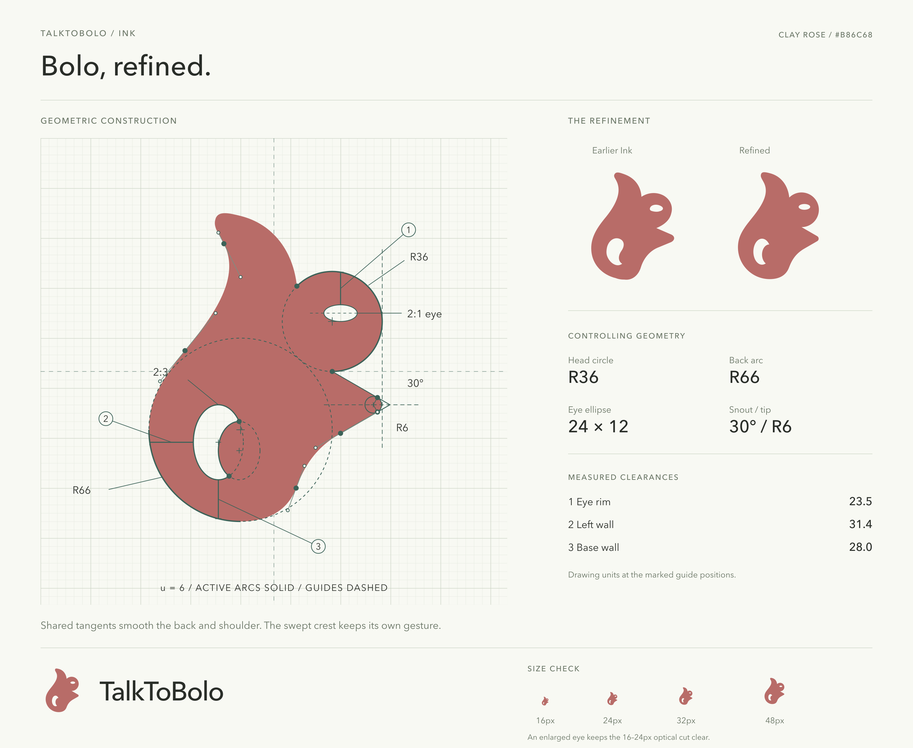

# TalkToBolo / Bolo

**Bolo** is the squirrel mascot for **TalkToBolo**. The approved logo evolved from the **Ink** concept and keeps its clay rose color, **`#B86C68`**. Its swept crest and crescent counter retain the original handdrawn character, while the head, back, snout, and eye use deliberate geometric construction.

## Design files

- [Editable design board](ink-design-board.svg) and [PNG preview](ink-design-board.png)
- [Construction drawing](ink-construction.svg), including the grid, tangent handles, guide shapes, and measured clearances
- [Geometry data](ink-geometry.json), using the original 336 × 336 drawing coordinates
- [Canonical master logo](../../assets/brand/studycall-ink.svg)
- [Canonical small optical logo](../../assets/brand/studycall-ink-small.svg)
- [512-pixel transparent PNG export](../../assets/brand/studycall-ink.png)

The head uses a radius of 36 drawing units and the back uses a radius of 66. The snout follows rays at ±30° from its horizontal bisector, with a radius of 6 at the tip. Two offset ellipses define the crescent counter. The crest remains a custom curve.

The master eye is a 24 × 12 ellipse. Use the small optical variant, with its 28 × 16 eye, for icons displayed at 16–24 pixels. Use the master for larger navigation marks, wordmarks, and illustrations. Both variants retain the same silhouette and clay rose color.

## Keeping application assets in sync

Treat the SVGs in `assets/brand/` as the source of truth. Update these files first, regenerate the 512-pixel transparent square PNG, then refresh the following copies in **both** `apps/web/public/` and `apps/landing/public/`:

| Canonical asset | Application public filename |
| --- | --- |
| `assets/brand/studycall-ink.svg` | `studycall-logo.svg` |
| `assets/brand/studycall-ink-small.svg` | `studycall-logo-small.svg` |
| `assets/brand/studycall-ink.png` | `studycall-logo.png` |

Keep the public copies identical to their corresponding canonical asset; do not redraw or independently edit application copies. The PNG remains available as a compatibility export. Regenerate any additional derived favicon files when changing the artwork.

This folder preserves the approved design and its construction. Earlier explorations remain in `output/brand/`.
